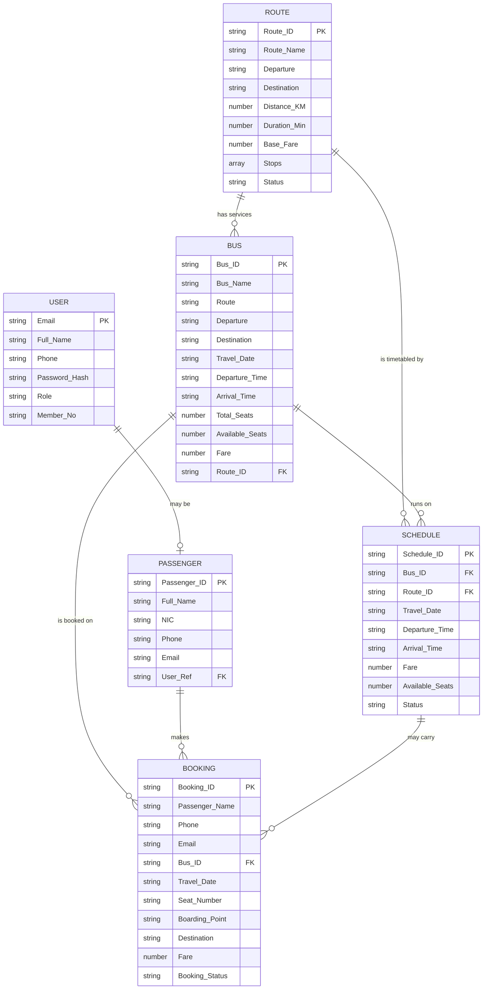

# MetroFlow — Database Design

MongoDB 9 via Mongoose 8. Database name `metroflow`, connection string in
`.env` as `MONGO_URI` (default `mongodb://127.0.0.1:27017/metroflow`).

Every schema uses `timestamps: true`, so each document carries `createdAt`
and `updatedAt`. `versionKey` is off (`__v` is never stored) and `_id` is
stripped from API responses, because the public identifier is always the
business key (`Bus_ID`, `Booking_ID`, …).

---

## 1. Collections

### 1.1 `routes` — the fixed corridors

A route is the corridor itself ("Colombo – Kandy"); a bus is one service on
that corridor on one date.

| Field | Type | Rules |
|---|---|---|
| `Route_ID` | String | **unique**, `^R\d{3,5}$`, e.g. `R001` |
| `Route_Name` | String | required, 3–80 chars |
| `Departure` | String | required, ≤ 60 |
| `Destination` | String | required, ≤ 60 |
| `Distance_KM` | Number | required, 1–2000 |
| `Duration_Min` | Number | required, 1–2880 |
| `Base_Fare` | Number | required, ≥ 0 |
| `Stops` | [String] | ≤ 25 entries |
| `Status` | String | `Active` \| `Inactive`, default `Active` |

```json
{
  "Route_ID": "R001",
  "Route_Name": "Colombo - Kandy",
  "Departure": "Colombo",
  "Destination": "Kandy",
  "Distance_KM": 115,
  "Duration_Min": 195,
  "Base_Fare": 1850,
  "Stops": ["Kadawatha", "Nittambuwa", "Kegalle", "Mawanella", "Peradeniya"],
  "Status": "Active",
  "createdAt": "2026-11-07T09:12:04.551Z",
  "updatedAt": "2026-11-07T09:12:04.551Z"
}
```

### 1.2 `buses` — one service on one date

The eleven assignment fields are stored **on the document**, exactly as the
brief specifies. `Route_ID` / `Route_Ref` are additive: no response shape
changed when they were introduced.

| Field | Type | Rules |
|---|---|---|
| `Bus_ID` | String | **unique**, `^[A-Z]{2}\d{3,6}$`, e.g. `MB1001` |
| `Bus_Name` | String | required, ≤ 60 |
| `Route` | String | required, ≤ 80 |
| `Departure` / `Destination` | String | required, ≤ 60 |
| `Travel_Date` | String | required, `YYYY-MM-DD` |
| `Departure_Time` / `Arrival_Time` | String | required, `HH:mm` |
| `Total_Seats` | Number | required, 1–52 |
| `Available_Seats` | Number | 0 … `Total_Seats` |
| `Fare` | Number | required, ≥ 0 |
| `Route_ID` | String | *additive* — `^R\d{3,5}$` |
| `Route_Ref` | ObjectId → `routes` | *additive* |
| `Bus_Type`, `Plate_No` | String | *additive*, optional |
| `Status` | String | *additive*, `Active` \| `Available` \| `Inactive`, **no default** |

> `Status` deliberately has no default. `bookingService` refuses to book a bus
> whose `Status` is set to anything it does not recognise, so defaulting this
> field made every bus unbookable. Left unset, a bus behaves as it always did.

```json
{
  "Bus_ID": "MB1001",
  "Bus_Name": "Metro Express",
  "Route": "Colombo - Kandy",
  "Departure": "Colombo",
  "Destination": "Kandy",
  "Travel_Date": "2026-11-07",
  "Departure_Time": "06:30",
  "Arrival_Time": "09:45",
  "Total_Seats": 48,
  "Available_Seats": 42,
  "Fare": 1850,
  "Route_ID": "R001",
  "Route_Ref": "6aeef5e402bf42074d39f9c1",
  "Bus_Type": "Luxury",
  "Plate_No": "NA-1001"
}
```

### 1.3 `schedules` — one running of one bus

| Field | Type | Rules |
|---|---|---|
| `Schedule_ID` | String | **unique**, `^S\d{3,5}$` |
| `Bus_ID` | String | required, `^[A-Z]{2}\d{3,6}$` |
| `Route_ID` | String | `^R\d{3,5}$` |
| `Bus_Ref` | ObjectId → `buses` | |
| `Route_Ref` | ObjectId → `routes` | |
| `Travel_Date` | String | required, `YYYY-MM-DD` |
| `Departure_Time` / `Arrival_Time` | String | required, `HH:mm` |
| `Fare` | Number | ≥ 0 |
| `Available_Seats` | Number | 0–52 |
| `Next_Day` | Boolean | set when arrival ≤ departure (overnight run) |
| `Status` | String | `Scheduled` \| `Departed` \| `Cancelled` |

Creating or updating a schedule writes `Travel_Date`, the two times and
`Fare` through to the linked bus, so the two can never disagree.

```json
{
  "Schedule_ID": "S001",
  "Bus_ID": "MB1001",
  "Route_ID": "R001",
  "Travel_Date": "2026-11-07",
  "Departure_Time": "06:30",
  "Arrival_Time": "09:45",
  "Fare": 1850,
  "Available_Seats": 42,
  "Next_Day": false,
  "Status": "Scheduled"
}
```

### 1.4 `passengers` — people who travel

| Field | Type | Rules |
|---|---|---|
| `Passenger_ID` | String | **unique**, `^P\d{4,6}$`, assigned by the server |
| `Full_Name` | String | required, 2–60. Alias **`Passenger_Name`** (the brief's name) — both work in and out |
| `NIC` | String | **optional**, unique *sparse* |
| `Phone` | String | required, `^(\+94\|0)7\d{8}$` |
| `Email` | String | required, valid, lowercased |
| `Address`, `Gender` | String | optional |
| `User_Ref` | ObjectId → `users` | optional, null for guests |

> `NIC` is optional and *sparse*-unique on purpose. Creating a booking upserts
> a passenger from name + phone + email, and a traveller gives no NIC at that
> point; a plain unique index rejected the second such document because both
> had `NIC: null`.

```json
{
  "Passenger_ID": "P0001",
  "Full_Name": "Nimal Perera",
  "Passenger_Name": "Nimal Perera",
  "Phone": "0771234567",
  "Email": "nimal.perera@example.com",
  "Address": "",
  "Gender": "",
  "User_Ref": null
}
```

### 1.5 `bookings` — a seat held on a service

| Field | Type | Rules |
|---|---|---|
| `Booking_ID` | String | **unique**, `BK<YYYYMMDD><NNN>` |
| `Passenger_Name` | String | required |
| `Phone` | String | required, `^(\+94\|0)7\d{8}$` |
| `Email` | String | required, valid |
| `Bus_ID` | String | required |
| `Travel_Date` | String | `YYYY-MM-DD`, **copied from the bus** |
| `Seat_Number` | String | `^[A-M][1-4]$` |
| `Boarding_Point` | String | required |
| `Destination` | String | **copied from the bus** |
| `Fare` | Number | **copied from the bus** |
| `Booking_Status` | String | `Confirmed` \| `Cancelled` |
| `Bus_Ref` / `Passenger_Ref` / `Schedule_Ref` | ObjectId | *additive* references |
| `Schedule_ID` | String | *additive* |

`Travel_Date`, `Destination` and `Fare` are read from the bus and never from
the request, so a client cannot choose its own fare.

```json
{
  "Booking_ID": "BK20261107001",
  "Passenger_Name": "Nimal Perera",
  "Phone": "0771234567",
  "Email": "nimal.perera@example.com",
  "Bus_ID": "MB1001",
  "Travel_Date": "2026-11-07",
  "Seat_Number": "A1",
  "Boarding_Point": "Colombo",
  "Destination": "Kandy",
  "Fare": 1850,
  "Booking_Status": "Confirmed",
  "Bus_Ref": "6aeef5e402bf42074d39f9c5",
  "Passenger_Ref": "6aeef5e402bf42074d39fa02"
}
```

### 1.6 `users` and `messages` — unchanged

`users` holds accounts and the bcrypt `Password_Hash` (`select: false`, so it
can never leak into a response). `messages` holds contact-form submissions.
Neither was modified by this work.

---

## 2. Relationships



In words:

* Route **1 ─ ∗** Bus, Route **1 ─ ∗** Schedule
* Bus **1 ─ ∗** Schedule, Bus **1 ─ ∗** Booking
* Passenger **1 ─ ∗** Booking
* Schedule **1 ─ ∗** Booking (optional)
* User **1 ─ 0..1** Passenger

Both sides are kept: the ObjectId `*_Ref` fields drive `populate()`, while the
business keys (`Bus_ID`, `Route_ID`, …) stay on the document so a query or a
response never needs a join.

---

## 3. Indexes

| Collection | Index | Purpose |
|---|---|---|
| `routes` | `Route_ID` **unique** | public key |
| | `(Departure, Destination)` **unique** | one corridor per city pair |
| | `Status` | filter active routes |
| `buses` | `Bus_ID` **unique** | public key |
| | `(Departure, Destination, Travel_Date)` | the search page's exact filter |
| | `Travel_Date` | "buses on this date" |
| | `Route_ID` | route → services |
| `schedules` | `Schedule_ID` **unique** | public key |
| | `(Bus_ID, Travel_Date, Departure_Time)` **unique** | a bus cannot run twice at once |
| | `Travel_Date`, `(Route_ID, Travel_Date)`, `Status` | timetable queries |
| `passengers` | `Passenger_ID` **unique** | public key |
| | `NIC` **unique sparse** | unique when present, absent allowed |
| | `(Email, Phone)` **unique** | the booking-time upsert key |
| | `Full_Name`, `Phone`, `Email` | admin search box |
| `bookings` | `Booking_ID` **unique** | public key |
| | **`(Bus_ID, Travel_Date, Seat_Number)` unique, partial on `Booking_Status: "Confirmed"`** | **prevents double booking even under a race** |
| | `Bus_ID`, `Travel_Date`, `Email`, `Phone`, `Passenger_Name` | the My Trips lookups |

### The seat lock

```js
bookingSchema.index(
  { Bus_ID: 1, Travel_Date: 1, Seat_Number: 1 },
  { unique: true, partialFilterExpression: { Booking_Status: 'Confirmed' } }
);
```

Because the index is **partial**, only `Confirmed` rows participate. Two
simultaneous requests for seat A1 cannot both succeed — the second gets a
duplicate-key error, which the API turns into `409 Seat already booked`. When
a booking is cancelled it leaves the index, so the seat can be sold again
while the cancelled row stays as history.

---

## 4. Integrity rules enforced in the service layer

| Rule | Behaviour |
|---|---|
| Booking needs an existing bus | `404` if the `Bus_ID` is unknown |
| Seat must be free | `409 Seat already booked` |
| Seats must remain | `409` when `Available_Seats` is 0 |
| `Available_Seats` decrement | atomic `findOneAndUpdate({Bus_ID, Available_Seats: {$gt: 0}}, {$inc: {Available_Seats: -1}})`, rolled back if the booking fails to save |
| Cancel | only `Confirmed` can be cancelled (`409` otherwise); increments `Available_Seats`, never above `Total_Seats` |
| Edit a booking | only `Passenger_Name`, `Phone`, `Email`, `Seat_Number`, `Boarding_Point`; a seat change re-checks availability; cancelled bookings cannot be edited (`409`) |
| Delete a bus | `409` while it holds `Confirmed` bookings |
| Delete a route | `409` while buses or schedules reference it |
| Delete a passenger | `409` while they hold `Confirmed` bookings |
| Fare / Destination / Travel_Date | always taken from the bus, never from the client |

---

## 5. Seeding and migration

| Command | What it does |
|---|---|
| `npm run seed` | Upserts 8 routes, 15 buses, 15 schedules, 12 passengers, ~78 bookings, 12 destinations and the admin user. Every write is a `bulkWrite` upsert on the business key, so running it twice changes nothing. |
| `npm run seed -- --keep` | Only fills collections that are empty. |
| `npm run seed -- --fresh` | **Deletes** routes/buses/schedules/passengers/bookings first, then seeds. Users and messages are never touched. |
| `npm run migrate` | Brings an existing database up to the referenced schema without deleting anything: creates the routes, schedules and passengers implied by existing buses and bookings, and back-fills every `*_Ref`. Safe to run repeatedly. |
| `node server/seed/reindex.js` | Drops indexes whose definition changed in a model and rebuilds them. Needed once after `NIC` became sparse, because MongoDB does not alter an existing index when the schema changes. |

The seed guarantees the consistency rule by construction: bookings are
generated **from** each bus's `Available_Seats`, and a final reconciliation
pass recomputes `Available_Seats` from the bookings actually in the database,
so `Total_Seats − Confirmed = Available_Seats` holds for every bus.
